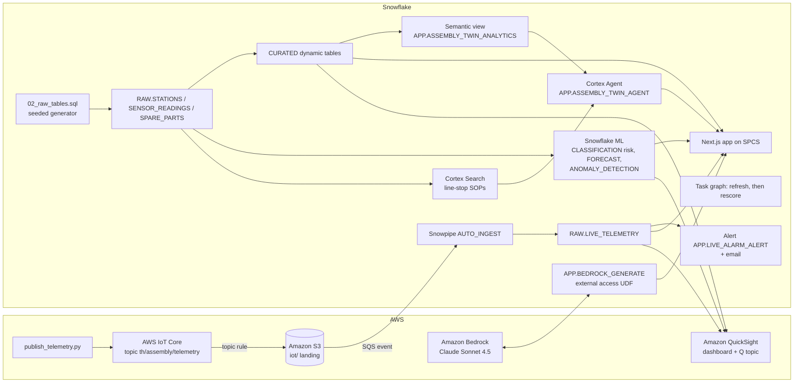

# Thai Assembly Line Digital Twin - Automotive

A digital twin of **24 assembly stations across 6 Thai plant cities** (Rayong, Chonburi, Chachoengsao, Ayutthaya, Samut Prakan, Prachinburi) of a fictional vehicle assembler, built on Snowflake and optionally AWS: from a live reading on a body weld cell, paint booth, trim and chassis station or end-of-line test cell to a line-stop risk score, an alarm email and an AI action memo.

## Architecture

An assembly line digital twin built on **Snowflake** (Dynamic Tables, Snowflake ML, Cortex Search, Cortex Agent, Cortex AI_COMPLETE, SPCS) and, in the full build, **AWS** (IoT Core, S3, Bedrock Claude, QuickSight + Amazon Q). Station telemetry lands in `RAW.LIVE_TELEMETRY`. Dynamic tables curate 90 days of station-day history into availability, line-stop and MTBF metrics. Snowflake ML scores each station's 7-day line-stop risk, forecasts plant-network line-stop hours and flags vibration anomalies. A Cortex Agent answers questions with SOP citations, and an LLM drafts the line-stop action memo.

Interactive diagrams (hover for object names): [Snowflake only](docs/architecture-snowflake.html) | [AWS + Snowflake](docs/architecture-aws.html). The app shows both diagrams on its Architecture & Data tab, the current build first. Regenerate both with `python3 docs/build_architecture.py aws` and `python3 docs/build_architecture.py snowflake`.



The Snowflake-only build drops the AWS subgraph: `APP.SIMULATE_TELEMETRY` writes to `RAW.LIVE_TELEMETRY`, and the app calls Cortex `AI_COMPLETE` instead of the Bedrock UDF.

## Snowflake Capabilities

| Capability | Implementation |
|-----------|---------------|
| Dynamic Tables | `CURATED.KPI_SUMMARY`, `PERFORMANCE_SUMMARY`, `DOWNTIME_CAUSES`, `TREND_ANALYSIS` from the RAW tables |
| Snowflake ML | CLASSIFICATION 7-day line-stop risk (`ML.FAILURE_RISK_SCORES`), 14-day line-stop hours FORECAST, station vibration ANOMALY_DETECTION |
| Cortex Search | 15 synthetic SOPs (one per station type and stop cause) in `SEARCH.STATION_SOP_SEARCH` |
| Semantic View | `APP.ASSEMBLY_TWIN_ANALYTICS` over stations, stop causes and risk |
| Cortex Agent | `APP.ASSEMBLY_TWIN_AGENT`: Cortex Analyst over the semantic view plus Cortex Search for SOP citations |
| Cortex AI | `AI_COMPLETE('claude-sonnet-4-5')` for grounded answers, and for the action memo in the Snowflake-only build |
| Alerts + Tasks | `APP.LIVE_ALARM_ALERT` logs ALARM readings and sends email; task graph `TASK_REFRESH_CURATED`, then `TASK_RESCORE_RISK` |
| Snowpark Container Services | Next.js app `APP.TH_AUTOMOTIVE_ASSEMBLY_TWIN_APP` with 6 tabs: Executive Cockpit, Predictive, Line Planning, Live IoT, Ask AI, Architecture & Data |
| Snowpipe | `RAW.LIVE_TELEMETRY_PIPE` AUTO_INGEST from S3 (AWS build only) |

## AWS Services

Used only in the AWS + Snowflake build.

| Service | Role in Demo |
|---------|-------------|
| AWS IoT Core | Receives simulated station telemetry on `th/assembly/telemetry`. A topic rule writes each message to S3 |
| Amazon S3 | Landing bucket. An event notification goes to the Snowpipe SQS queue |
| Amazon Bedrock | Claude Sonnet 4.5 writes the action memo, called from Snowflake through an external-access UDF |
| Amazon QuickSight | DIRECT_QUERY executive dashboard over Snowflake (line-stop hours by station, daily availability, line-stop risk) |
| Amazon Q | Natural-language questions over the QuickSight topic `th-automotive-assembly-twin-topic` |
| AWS IAM / Secrets Manager | Least-privilege roles for S3, IoT and Bedrock; the QuickSight service credential |

## Personas

These personas, and the vehicle assembler they work for, are fictional.

| Persona | Role | Key Questions |
|---------|------|---------------|
| **Kanokwan Thepsuwan** | VP Vehicle Assembly Operations | "Which plants and stations drive line-stop hours?" "What is station availability across the six plants?" |
| **Thanakorn Rattanachai** | Line Digital Twin Engineer | "Which stations are high line-stop risk this week, and which SOP applies?" "Are the lineside spares on hand?" |

## Data

All data is synthetic and seeded, so every rebuild reproduces it.

| Table | Rows | Description |
|-------|------|-------------|
| RAW.STATIONS | 24 | Assembly stations across 6 Thai plant cities and 4 station types (Body Weld Cell, Paint Booth, Trim and Chassis Station, End-of-Line Test Cell) |
| RAW.SENSOR_READINGS | 2,160 | Daily station observations over 90 days: planned, operating and line-stop hours, stops, stop cause, PM, jobs and first-pass good jobs, vibration and motor temperature |
| RAW.SPARE_PARTS | 24 | Required, on-hand and on-order lineside spares per station (weld tip kits, atomizer bell cups, torque tool transducers, dyno roller bearings) |
| SEARCH.STATION_DOCS | 15 | Synthetic line-stop SOPs indexed for Cortex Search |
| RAW.LIVE_TELEMETRY | Grows during the demo | Live readings from IoT Core (AWS build) or `APP.SIMULATE_TELEMETRY` (Snowflake-only build) |
| ML.FAILURE_RISK_SCORES | 24 | 7-day line-stop probability and risk band per station |

## Build Instructions

### Prerequisites
- Snowflake account with ACCOUNTADMIN access, and Cortex AI enabled (AI_COMPLETE, Search, Agent).
- An X-Small warehouse with auto-suspend at or below 120 s, and an existing SPCS compute pool.
- Python 3.11+, `snowflake-connector-python`, Node.js 22+, Docker and the `snow` CLI.
- App image: create the `APP.IMAGES` image repository, run `snow spcs image-registry login`, then build (`--platform linux/amd64`) and push `th-automotive-assembly-twin-app:v1` to it (see the header of `snowflake/07_deploy_app.sql`).
- AWS build only: `boto3`, AWS credentials for the target account (us-west-2) with Bedrock access, and QuickSight Enterprise.

### SPCS App
```
<DATABASE>.APP.TH_AUTOMOTIVE_ASSEMBLY_TWIN_APP
```

### Tests
```bash
python -m pytest aws snowflake quicksight
```

The AWS tests also validate the IoT Core `CreateTopicRule` and `Publish` requests against the botocore service models, without calling AWS.

For a local run, put `SNOWFLAKE_ACCOUNT`, `SNOWFLAKE_USER`, `SNOWFLAKE_DATABASE`, `SNOWFLAKE_WAREHOUSE`, `SNOWFLAKE_AUTHENTICATOR=PROGRAMMATIC_ACCESS_TOKEN`, `SNOWFLAKE_TOKEN` and `DEMO_PLATFORM` in the environment, then run `npm --prefix app run build && npm --prefix app start`.

## Build Modes

Both modes share the same core. They differ in three places, and the app's `DEMO_PLATFORM` setting (in its SPCS spec) switches the memo provider, the Live IoT tab copy and the diagram order.

| Layer | Snowflake Only | Full AWS + Snowflake |
|---|---|---|
| Live telemetry | `CALL APP.SIMULATE_TELEMETRY(n)` inserts simulated readings into `RAW.LIVE_TELEMETRY`. This simulates a station sensor feed; it is not Snowpipe Streaming | `aws/publish_telemetry.py` to AWS IoT Core, then S3, SQS and Snowpipe AUTO_INGEST |
| Action memo | Cortex `AI_COMPLETE('claude-sonnet-4-5')` | Amazon Bedrock Claude Sonnet 4.5 through `APP.BEDROCK_GENERATE` |
| BI and natural-language questions | The SPCS app is the dashboard; questions go to the Cortex Agent | Also a QuickSight dashboard and an Amazon Q topic |
| App setting | `DEMO_PLATFORM: snowflake` | `DEMO_PLATFORM: aws` |

### Snowflake Only

```bash
# 1. Core data and dynamic tables (guarded: new isolated database only)
python snowflake/run_core.py --database THAILAND_AUTOMOTIVE_ASSEMBLY_TWIN_SNOWFLAKE --warehouse <XS_WAREHOUSE> --connection <CONNECTION> --apply
# 2. Native telemetry, ML, search, semantic view, agent, alert and task graph
python snowflake/run_intelligence.py --database THAILAND_AUTOMOTIVE_ASSEMBLY_TWIN_SNOWFLAKE --platform snowflake --warehouse <XS_WAREHOUSE> --connection <CONNECTION> --alert-email you@example.com
# 3. App on SPCS with DEMO_PLATFORM=snowflake (push the image first)
python snowflake/run_intelligence.py --database THAILAND_AUTOMOTIVE_ASSEMBLY_TWIN_SNOWFLAKE --platform snowflake --warehouse <XS_WAREHOUSE> --connection <CONNECTION> --alert-email you@example.com --files 07_deploy_app.sql --compute-pool <COMPUTE_POOL>
```

During the demo:
- Run `CALL APP.SIMULATE_TELEMETRY(20)` to add live readings. For a continuous feed, run `ALTER TASK APP.TASK_SIMULATE_TELEMETRY RESUME`, and `SUSPEND` it afterwards.
- Run `EXECUTE ALERT APP.LIVE_ALARM_ALERT` to raise the alarm email.
- Run `EXECUTE TASK APP.TASK_REFRESH_CURATED` to refresh the curated tables and rescore line-stop risk.

Afterwards, drop the database or run `ALTER SERVICE APP.TH_AUTOMOTIVE_ASSEMBLY_TWIN_APP SUSPEND`.

### Full AWS + Snowflake

```bash
# 1. Core data and dynamic tables (guarded: new isolated database only)
python snowflake/run_core.py --database THAILAND_AUTOMOTIVE_ASSEMBLY_TWIN_AWS --warehouse <XS_WAREHOUSE> --connection <CONNECTION> --apply
# 2. AWS ingestion and Bedrock (dry run first, then --apply)
python aws/setup_aws.py --database THAILAND_AUTOMOTIVE_ASSEMBLY_TWIN_AWS --account <AWS_ACCOUNT_ID> --connection <CONNECTION> --apply
# 3. ML, search, semantic view, agent, alert and task graph
python snowflake/run_intelligence.py --database THAILAND_AUTOMOTIVE_ASSEMBLY_TWIN_AWS --platform aws --warehouse <XS_WAREHOUSE> --connection <CONNECTION> --alert-email you@example.com
# 4. App on SPCS with DEMO_PLATFORM=aws (push the image first)
python snowflake/run_intelligence.py --database THAILAND_AUTOMOTIVE_ASSEMBLY_TWIN_AWS --platform aws --warehouse <XS_WAREHOUSE> --connection <CONNECTION> --alert-email you@example.com --files 07_deploy_app.sql --compute-pool <COMPUTE_POOL>
# 5. QuickSight dashboard and Q topic (needs an existing Snowflake data source)
python quicksight/build_dashboards.py --database THAILAND_AUTOMOTIVE_ASSEMBLY_TWIN_AWS ... --apply --update --with-topic
```

QuickSight objects must be shared with the QuickSight user who signs in (`--principal-arn`); otherwise the console shows nothing.

During the demo:
- Run `python aws/publish_telemetry.py --count 20` to send live readings.
- Run `EXECUTE ALERT APP.LIVE_ALARM_ALERT` to raise the alarm email.
- Run `EXECUTE TASK APP.TASK_REFRESH_CURATED` to refresh the curated tables and rescore line-stop risk.

Afterwards, `python aws/teardown_aws.py ... --apply` removes the AWS resources and the account-level Bedrock external-access and S3 storage integrations. It leaves the email integration `TH_AUTOMOTIVE_ASSEMBLY_TWIN_EMAIL_INT`, which the Snowflake-only build also uses.

Renaming a demo database is not transparent:
- Recreate the SPCS service, and re-run `06_intelligence.sql`, because the agent spec names the database.
- Repoint `TH_AUTOMOTIVE_ASSEMBLY_TWIN_BEDROCK_EAI` at the renamed secret and network rule.
- Update the QuickSight data source and datasets with `build_dashboards.py --update`.

The service's ingress URL changes when the service is recreated.

## Business Impact

Industry research and Snowflake customer outcomes:
- **Every unproductive hour now costs automotive manufacturers $2.3 million**, a twofold increase from 2019, according to a Siemens survey of downtime costs -- [Siemens Blog, The True Cost of an Hour's Downtime: An Industry Analysis](https://blog.siemens.com/2024/07/the-true-cost-of-an-hours-downtime-an-industry-analysis/)
- **Molex** (Snowflake customer), a manufacturer of connectors, "is using the Snowflake Manufacturing Data Cloud to fuel their digital transformation journey, including sharing data securely across the organization and with external partners and generating manufacturing shop-floor and business KPIs" -- [Snowflake Manufacturing Data Cloud press release](https://www.snowflake.com/en/news/press-releases/snowflake-launches-manufacturing-data-cloud-to-improve-supply-chain-performance-and-power-smart-manufacturing/)
- **Shop-floor IoT data in Snowflake**: the same release describes "leveraging shop floor data in near real-time to predict maintenance needs, analyze cycle time, improve product yield and quality". This is a product description, not a customer outcome -- [same press release](https://www.snowflake.com/en/news/press-releases/snowflake-launches-manufacturing-data-cloud-to-improve-supply-chain-performance-and-power-smart-manufacturing/)

## Key Demo Numbers

These figures are synthetic and come from the seeded demo data. Forecast and anomaly figures can shift slightly with the build day.

- **24 assembly stations**, 2,160 station-days over 90 days, across 6 Thai plant cities
- **Station availability 99.01%**; per-station availability ranges from 96.21% to 100%; Prachinburi is the lowest plant city at 98.51%
- **154 unplanned line stops** across 13 stop causes; body weld cells lose the most hours (148.4 h), and robot servo faults are the top cause (57.1 h)
- **Line-stop risk model** out-of-time holdout: precision 0.54, recall 0.39 at a 0.5 threshold, against a 0.33 base rate. The top station is STN-0021, at 99.53%
- **14-day line-stop hours forecast** with prediction intervals; **14 of 384** station-days flagged as vibration anomalies
- **15 SOPs** indexed for Cortex Search and cited by ID in agent answers

## License

Apache 2.0 — See [LICENSE](LICENSE) for details.

This is a personal demo project and is not an official Snowflake offering. It comes with no support or warranty. Companies, plants, stations and personas in the demo are fictional. Industry metrics cited are from publicly available third-party research and Snowflake customer stories; they represent reported outcomes and are not guarantees of results.
